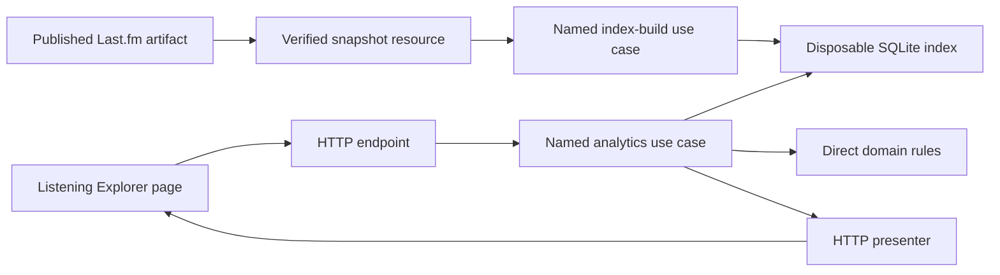

# Last.fm Listening Explorer: survey and implementation plan

Prepared 16 November 2026. Approved by the owner on 16 November 2026. The owner authorized implementing the core and discovery/rediscovery views through one release candidate before requesting revision. PR #90 was approved, deployed, verified, and merged on 16 November 2026. PR #91 was approved on 17 November 2026; Time Capsule completes Musical Eras and On This Day and was deployed and verified before merge. On 20 November 2026, the owner selected current-library comparisons for Item 4. PR #92 was approved, deployed and verified on 21 November 2026. The Library Bridge release uses published saved albums, liked tracks and followed artists with explicit name evidence; metadata enrichment remains follow-up scope. See RELEASE_VERIFICATION.md and TIME_CAPSULE_RELEASE.md for delivery evidence.

## Recommendation

Add a companion **Listening Explorer** page at `/lastfm`, linked from the Last.fm row of the Data Signal Board. Use the existing published scrobble history, the current password gate, and the existing FastAPI deployment. Start with coordinated charts that answer four questions:

1. When and how consistently do I listen?
2. How has my taste changed?
3. Which discoveries became lasting favorites?
4. Which favorites have I forgotten?

The first release should cover activity, rankings, taste evolution, and entity details. A second release adds discovery and rediscovery. Metadata enrichment and Spotify actions come later. The completed backend refactor remains the architectural baseline; this feature does not require restructuring the existing frontend.

## 1. Survey of existing visualizations

The survey uses current public product pages, documentation, and project source documentation. It is a feature survey, not a signed-in usability or performance test. Recommendations below are design judgments for this application.

| Reference | Existing approach | What to borrow | Trade-off for our page |
| --- | --- | --- | --- |
| [Last.fm Stats](https://github.com/felhag/lastfm-stats-web) | Streaks, date filters, rankings, timelines, punchcards, scatter charts, races, discovery and diversity charts; import/export. | Broad time-based exploration and entity drill-down. | A large catalog of independent charts can be hard to navigate. Organize ours around questions and shared filters. |
| [Last.fm Labs](https://www.last.fm/labs) | Artist Velocity, The Wall, Pixel Grid, Bubbles, Album Quilt. | Comparing artist trajectories; visual calendar summaries; a later album collage. | Bubbles and cover grids work well as visual summaries, but ranked bars make quantities easier to compare. The Labs feature list was available in the search index; direct retrieval was blocked. |
| [Lastfmlists](https://lastfmlists.com/faq/) | Filterable lists, monthly and cumulative graphs, rank histories, side-by-side comparisons, chart races, image/GIF exports. | Useful filters, comparison views, and graph-to-list navigation. | Keep common filters prominent and advanced options secondary. Its metadata-dependent filters illustrate why enrichment should be separate. |
| [bijou.fm](https://www.bijou.fm/) | Bars, pies, grids, flexible date ranges, year-by-year exploration, comparisons, and milestones. | A polished overview and convenient transitions between periods. | Borrow its presentation patterns without expanding this personal tool into a social analytics product. |
| [Last.fm Tools](https://nroutasuo.github.io/lastfm-vis/) | Tag timeline, tag cloud, artist timeline, album charter. | Artist timelines now; tag evolution after enrichment. | Tags do not exist in our canonical export and need a separate metadata source. |
| [VizFM](https://vizfm.cd3dtech.com/about) | A navigable point-per-scrobble history, artist colors, cached retrieval, and exports; its documentation describes hundreds of thousands of points. | Zoomable listening archaeology and stable artist colors. | A full point cloud is a good optional detail view. Aggregated charts are a clearer first screen and lighter on mobile. |
| [LastGraph](https://lastgraph.aeracode.org/) — historical | The service is closed; its notice attributes the closure to failures retrieving Last.fm data. | Historical inspiration for long-term taste visualization, rather than an operational dependency. | Keep our page usable from already published history even when an external service is unavailable. |

The strongest combination for this app is Last.fm Stats' analytical breadth, Lastfmlists' exploration, and a restrained overview inspired by bijou.fm. The distinct benefit here is connecting nearly two decades of listening history to the user's existing music-management context.

## 2. What the repository already provides

### Verified local data

Read-only inspection of `spotify_manager/files/lastfmstats-man-et-arms.json` found:

| Property | Observation |
| --- | --- |
| File size | 47,248,311 bytes, about 45.1 MiB |
| Scrobbles | 331,065 |
| Timestamp range | 26 November 2007, 23:10:53 UTC through 1 September 2026, 18:59:03 UTC |
| Raw artist names | 15,644 distinct strings |
| Raw artist/track pairs | 120,298 |
| Row fields | `track`, `artist`, `album`, `albumId`, `date` |
| Timestamp representation | Unix milliseconds; all inspected rows have integer dates |
| Missing album names | 1,944, approximately 0.59% |
| Missing artist/track names | None in this local copy |
| Populated album IDs | 256,255; preserve these as source identifiers, without assuming Spotify identity |
| Exact duplicate rows | None by timestamp/artist/album/track tuple in this copy |

These figures describe the **local file**, not a freshly verified durable publication or the current Last.fm account. The page must use the published artifact and report its own coverage. A first recorded scrobble means first observed in the available history, not the first time the person ever heard that music.

### Existing integration points

- `spotify_manager/web.py` serves the cockpit and `/genre-reveal`; use the latter as the companion-page integration pattern.
- `spotify_manager/_auth.py` and `domain/web_access.py` enforce `X-App-Password` on data routes. Shell pages are open so they can display login controls.
- The frontend uses the `sm_pw` credential convention; preserve its behavior and never put credentials in URLs.
- `core/library_data/service.py` supplies manifest metadata, immutable-revision reads, checksum verification, and atomic publication.
- `infrastructure/scrobble_downloads.py` acquires independently owned, verified published snapshots. Reuse this storage boundary for analytics builds, keeping its current download contract unchanged.
- `domain/history.py` supplies a typed `Scrobble`. Existing normalization removes accents and punctuation; that behavior is appropriate to preserve for existing routines but deserves a separate identity decision for analytics.
- Python 3.14, FastAPI, Pydantic, strict business-layer typing, and existing architecture/coverage checks are already configured.

## 3. Suggested visualizations and release order

### Release A: core explorer

| View | Question and encoding | Interaction and acceptance |
| --- | --- | --- |
| Overview | Scrobbles, unique artists/tracks/albums, active days, and scrobbles per calendar day. | All values reflect the visible filter and source snapshot. Label calendar-day and active-day averages separately. |
| Listening calendar | Which days and seasons were busiest? One year of daily heatmap cells with year navigation. | Select a day to see its listening history. Distinguish zero recorded plays from dates outside coverage. |
| Weekly rhythm | When do I listen? A weekday × hour heatmap. | Show counts and a per-occurrence average so different date ranges remain interpretable. Selected timezone is explicit. |
| Top music | Which artists, albums, and tracks dominate this period? Horizontal bars with a sortable table. | Toggle entity type, search, and open details; paginate beyond the top 25. Album/track labels retain artist context. |
| Taste evolution | How did my favorite artists change? Monthly stacked area with counts/share toggle; top eight artists plus Other. | Fix series membership across the selected range so colors and shapes remain meaningful. Selecting an artist opens its timeline. Weekly buckets are available for short ranges. |
| Entity details | What is my history with this artist, album, or track? Period counts, lifetime first/last observed dates, monthly line, related tracks/albums, and paginated scrobbles. | Open as a drawer on desktop or full-width panel on mobile. Lifetime facts and filtered counts are explicitly labeled. |

Count charts and percentage charts answer different questions. Offer both for evolution: raw counts reveal volume, while share reveals taste changes despite changes in overall listening.

### Release B: features that make this page more personal

| Proposed view | Definition | Why it is useful |
| --- | --- | --- |
| Discovery that sticks | Monthly first-observed artists, with 7/30/90-day return rates. A return is at least one later scrobble on a different calendar day within the chosen window. | Distinguishes trying many artists from finding lasting favorites. Mark cohorts without a complete follow-up window as incomplete; do not count them as failures. |
| Forgotten favorites | Scatterplot of historical plays versus days since last recorded play, with a ranked table and adjustable minimum-play/gap thresholds. | Finds artists or albums that mattered but disappeared from recent listening. Start with transparent counts and gaps instead of an opaque recommendation score. |
| Obsession and breadth | Monthly top-artist share plus unique artists and tracks. | Shows periods of concentrated listening versus exploration without needing genre data. Avoid claims about mood or personality. |
| Then versus now | Two-period artist-share comparison, count deltas, and a slope chart for a limited top set. | Makes changes easier to inspect than an animated bar race. Compare equal-length periods by default; label partial coverage. |
| Musical eras | Optional month-to-month similarity heatmap using weighted Jaccard similarity over artist play shares. | Reveals returns to earlier listening patterns. Show the formula and avoid automatically claiming real-life causes for the clusters. |
| On this day | A compact list/timeline for the same month/day in earlier years. | Turns long history into an easy route for rediscovery. February 29 stays February 29. |

For Forgotten Favorites, lifetime plays and last-play dates are calculated from all available history **up to the selected analysis end**, not only inside the visible date range. Display the analysis date so future plays cannot leak into a retrospective view.

### Release C: optional enrichment

- Genre/tag evolution: cache artist tags with source, retrieval date, and coverage; describe the chart as applying available tags to historical plays, not as historical genre metadata.
- Artist-origin map: enrich from a suitable structured source, keep unknown and multiple origins visible, and distinguish artist origin from the listener's location.
- Album quilt: acquire covers separately, with missing-art fallbacks and an export that still works when images cannot be embedded.
- Library gaps: compare history to current Spotify mirrors to find historically loved music absent from the current library. Show match confidence and mirror age; unresolved matches remain unresolved.
- Optional listening-session explorer: group consecutive records with a configurable gap threshold. This is inferred activity, not measured continuous listening time.
- Dense scrobble map: show local-hour density across the selected calendar and
  show original points on bounded detail selections.

Exact listening minutes, skips, completion rates, audio features, mood, and historical location are not present in the export. Any later duration-derived number must be described as an estimate with coverage, never as actual time listened. Full-album completion also requires reliable tracklists and edition matching.

## 4. Page design and interactions

```text
Spotify Manager / Listening Explorer                 Back to cockpit
History through [timestamp] • Published [timestamp] • [Freshness status]

[30 days] [90 days] [12 months] [All time] [Custom dates]
[Timezone: Europe/Berlin] [Artist search] [Reset filters]

[Scrobbles] [Artists] [Tracks] [Albums] [Active days]

[Overview] [Taste over time] [Discoveries*] [Rediscover*]

Overview:
┌────────────────────────────────┬──────────────────────────────┐
│ Listening calendar             │ Weekday × hour rhythm        │
├────────────────────────────────┴──────────────────────────────┤
│ Top artists / albums / tracks            Chart ↔ Table        │
└───────────────────────────────────────────────────────────────┘

Taste over time:
┌───────────────────────────────────────────────────────────────┐
│ Monthly artist evolution                 Counts ↔ Share      │
└───────────────────────────────────────────────────────────────┘

Select an entity → detail panel and its recorded scrobbles
* Added in Release B; do not ship nonfunctional tabs.
```

Shared behavior:

- Presets end at the latest stored scrobble date, with that end date always visible. Users can select dates through today; later empty dates must remain distinguishable from confirmed coverage.
- Default to Europe/Berlin, with UTC and other validated IANA timezone choices. These are display/aggregation zones, not a reconstruction of travel history.
- Store date range, timezone, tab, and selected entity in URL parameters. Store presentation preferences only in browser storage.
- A chart click selects an entity or a date. Provide the same selection through normal table rows/buttons for keyboard users.
- Keep an artist detail selection distinct from a global artist filter; show filter chips so cross-chart effects are predictable.
- Cancel obsolete browser requests after filter changes and discard responses from older selections.
- Render only the active tab's charts. Mobile uses one column, fewer tick labels, and a full-width detail view.
- Show loading, no results, missing publication, building index, stale snapshot, and retry states explicitly.
- Export the current chart and filtered aggregate table as PNG/CSV, including dates, timezone, and source version. Retain the existing complete-history Download action.
- Provide textual summaries, table alternatives, visible focus, color-safe palettes, and reduced-motion behavior.

## 5. Technical design

### Components and data flow



Use vanilla JavaScript and **Apache ECharts**, with a pinned local distribution and its license notice. ECharts can be included directly in a static page without adding a frontend build pipeline; its documented event model supports chart selections and zoom interactions. Enable and verify accessibility features explicitly, then supplement them with our own tables. See [getting started](https://echarts.apache.org/handbook/en/get-started/), [events](https://echarts.apache.org/handbook/en/concepts/event/), and [accessibility](https://echarts.apache.org/handbook/en/best-practices/aria/).

ECharts is the proposed choice for this mix of chart types. Chart.js is a viable alternative for a smaller bar/line-only page, but its time scale also requires a date library and adapter ([documentation](https://www.chartjs.org/docs/latest/axes/cartesian/time.html)). D3 offers more drawing freedom at a larger implementation cost. Validate the ECharts calendar, rhythm, and area prototypes before committing to the choice.

### Data access and cache

Use Python's standard-library SQLite as a **rebuildable local analytics index**, separate from canonical files and routine state. At this data size it offers indexed filtering, pagination, and reusable aggregates without adding a database service. This is a proposal to benchmark, not a measured performance conclusion.

1. On an authenticated analytics visit, read published manifest metadata with a short bounded refresh interval, initially 60 seconds. Existing requests use the current ready generation.
2. If the scrobble checksum changed, acquire a verified published snapshot through the existing storage boundary. Never parse a mutable file being synchronized.
3. A single owned build task creates a new temporary SQLite generation. Its identity includes source checksum, parser/schema version, and analytics identity version.
4. Validate counts and integrity, then atomically publish the completed generation. Retain the previous generation while readers finish; clean up unreferenced generations afterward.
5. Close and remove the temporary source snapshot on success, failure, or shutdown. A build failure leaves the previous index available with a visible stale/error status.
6. A full publication replacement triggers a full rebuild, including when the row count stays unchanged. Timestamp-only append detection would miss corrections and deletions.

Store UTC milliseconds and source row ordinal, plus artist, album, and track dimensions and source album IDs. Add timestamp and entity/timestamp indexes. Preserve source rows rather than silently deduplicating them. Counts are exact recorded-row counts; data-quality warnings can flag suspected anomalies separately.

Use a typed `ListeningQuery` and named index-resource methods for external reads. Application functions call fixed domain rules directly. Bootstrap owns construction; presenters own HTTP shape. Follow ADR-003 rather than passing file readers, serializers, clocks, or workflow functions as execution callbacks.

Perform blocking file, SQLite, and aggregation work outside the event loop using the project's existing bounded blocking-work patterns. Tie build-task ownership and cleanup to the web lifespan. One build may run per generation; if multiple processes share the cache directory, use a tested process lock or isolate their cache directories.

Keep calendar bucketing in explicit `zoneinfo.ZoneInfo` conversion, not SQLite's machine-local timezone. Cache bucket/aggregate results by generation, query, timezone, and metric version. Bound caches and reuse the same normalized query across endpoints. No Last.fm or Spotify API calls are needed to render charts; storage access may check/download the published artifact.

### Identity and correctness

- Define an analytics-only identity policy: Unicode NFC, trimmed whitespace, and case folding, retaining accents and punctuation. Keep display spellings and aliases. Never change existing routine matching behavior to implement this page.
- Artist identity starts from the observed name; track identity includes artist and title; album identity includes artist and album title. Do not equate identical titles across artists or silently collapse remasters/editions.
- Preserve `albumId` for later corroboration; do not make it mandatory or assume it is a Spotify ID.
- Keep blank albums as missing metadata; exclude them from unique-album totals and report their scrobble count separately. Artist/track and total-scrobble views still include those plays.
- Validate row shape and timestamps when building. Corrupt source data must not produce a silently partial dashboard; retain the last ready index and report the failure.
- Interpret selected dates as local calendar boundaries and query a half-open UTC interval. DST days can contain 23 or 25 hours. For rhythm averages, use the actual number of occurrences of each local weekday/hour in the covered interval.
- First-observed dates are computed against the full available history, before the visible range filter. Discovery windows are bounded by observed coverage.
- A zero bucket means zero **recorded** scrobbles, not proof that no listening occurred or that scrobbling was functioning.
- Complete source publication and complete calendar coverage are different concepts. Display earliest/latest observations, known partial buckets, and missing-album counts.

### Proposed HTTP contract

All data endpoints below require the existing password header in the web wrapper. Shell/assets contain no listening data. Use narrow explicit open paths for `/lastfm`, its trailing-slash form, and its versioned static assets; never allow the whole `/lastfm/` namespace through the gate.

| Endpoint | Purpose |
| --- | --- |
| `GET /lastfm/analytics/status` | Ready/building/stale/missing/error state, source version, coverage, source publication time, and quality counts. |
| `GET /lastfm/analytics/overview` | Filtered summary metrics. |
| `GET /lastfm/analytics/activity` | Daily counts and weekday/hour cells with denominators. |
| `GET /lastfm/analytics/rankings` | Artist/album/track rankings, search, and pagination. |
| `GET /lastfm/analytics/evolution` | Bounded weekly/monthly artist series, including Other. |
| `GET /lastfm/analytics/entities/{kind}/{key}` | Entity detail and separately labeled lifetime facts. |
| `GET /lastfm/analytics/scrobbles` | Paginated filtered listening records. |
| `GET /lastfm/analytics/discovery` | Release B: first-observed cohorts and retention. |
| `GET /lastfm/analytics/rediscovery` | Release B: counts/gaps as of the analysis date. |

Analytics queries include validated `from`, `to`, `tz`, and a ready `snapshot` token; relevant endpoints additionally accept entity, grain, page, and limit values. Return the snapshot token and effective filters in each response. The browser obtains a ready token from status and uses it for all widgets so concurrent synchronization cannot mix source versions. If a token has expired, return a clear version-conflict response and refresh the whole selection.

Cap rankings at 100 rows per request, scrobble pages at 200, and evolution at eight selected artists plus Other. Reject invalid ranges/timezones and parameter combinations rather than silently altering their meaning. A cold build returns a building status and retry hint; data requests without a ready generation return a temporary-unavailable response. Missing publication links users back to the existing sync controls.

Use private, non-shared cache headers for protected responses. Keep credentials out of logs, exports, and links. Render external names as text rather than HTML. The existing ungated pure API entry point remains a trusted loopback interface; deployment uses the gated web wrapper.

### Proposed code locations

These names are an implementation map, not a requirement to create a file for every helper:

| Area | Additions or narrow changes |
| --- | --- |
| Frontend | `frontend/lastfm.html`, page-specific JS/CSS, pinned chart asset; a small link in `frontend/index.html`. |
| HTTP | A feature router with route declarations beside endpoints, typed request/response models, and direct presenter calls. Register it from `api.py`; avoid another forwarding facade. |
| Application | Named `get_listening_overview`, `get_listening_activity`, `get_listening_rankings`, and related use cases; typed queries/results and a cohesive index-resource port. |
| Domain | Analytics identity, temporal buckets, period comparison, discovery/retention, and gap rules. Reuse existing values where semantics match. |
| Infrastructure | Verified history acquisition, disposable SQLite generations, query implementations, and bounded aggregate caches. |
| Bootstrap/web | Resource construction, task lifetime, page/asset routes, and exact auth allowlist additions. |
| Documentation | Feature guide plus updates to Web App, Data and State, Architecture Specification, and the documentation index. |

Check frontend asset inclusion in the built wheel and the deployed Docker image. Avoid widening the public static directory to include files, snapshots, or caches.

## 6. Incremental implementation plan

Treat the following as a proposed feature sequence, separate from the already completed refactor roadmap. Each item should produce a concrete reviewable result. Follow the repository delivery order: clean current `master`, dedicated `codex/` branch, implementation and checks, commit and PR, local web review URL, user approval, Hugging Face deployment and verification, merge, cleanup, then the next item. This plan does not authorize deployment or merge.

### Item 1: source and analytics foundation

Deliver verified-snapshot acquisition, versioned SQLite generation, typed analytics queries, status/overview/activity/ranking APIs, and a minimal authenticated page showing coverage and totals. Prototype calendar/rhythm/area rendering to validate the chart library. Benchmark the actual published artifact and a synthetic million-row fixture.

Acceptance: totals reconcile with independent fixture expectations; overlapping sync/build/read operations always serve one complete generation; missing/corrupt source and restart behavior are visible and recoverable; no routine state or canonical file changes occur.

### Item 2: core explorer release

Deliver the complete Release A page: filters, calendar, rhythm, ranking tabs, monthly evolution, entity details, scrobble pagination, table alternatives, and aggregate/chart exports. Add the cockpit navigation link, login/401 recovery, loading/error states, responsive layout, and URL restoration.

Acceptance: every chart can lead to underlying entities or records; totals agree across views; changing filters does not leave old results on screen; the page works on desktop and mobile using the real published history. Existing cockpit, Genre Reveal, sync, and download behavior pass their regression checks.

### Item 3: discovery and rediscovery release

Deliver discovery/retention cohorts, Forgotten Favorites, concentration/breadth, and period comparisons. Include On This Day if it remains a small reuse of the indexed date queries. Keep Musical Eras as an optional follow-up rather than a launch dependency.

Acceptance: discovery dates use pre-range history; incomplete cohorts are marked; retrospective gap calculations ignore later plays; each insight has a definition and a route to supporting records.

### Item 4: optional enrichment and library bridge

After reviewing the core page, select specific enrichment views based on use. Add source-aware metadata caching, match evidence, unknown coverage, and current-library comparisons. Playlist creation or routine launch controls would be a separately scoped change with explicit user review.

Acceptance: historical exploration remains usable without enrichment services, failures never erase available counts, and uncertain matches/metadata do not become asserted facts.

Delivery: Library Bridge was approved, deployed, verified and merged in PR #92
on 21 November 2026. [Tag Atlas](TAG_ATLAS_RELEASE.md) followed in approved
PR #93, applying current community labels with bounded explicit lookups and
separate metadata versions. Its runtime is deployed and verified. [Artist Atlas](ARTIST_ATLAS_RELEASE.md),
approved in PR #94 on 22 November 2026, maps current country-association evidence
with explicit unresolved coverage. Its approved runtime was deployed and verified before merge.
[Album Quilt](ALBUM_QUILT_RELEASE.md) was approved in PR #95 on 22 November 2026; its runtime was deployed and verified before merge. Listening Sessions follows as the approved next increment. Fuzzy
resolution and playlist/routine actions remain separately scoped.

[Listening Sessions](SESSIONS_RELEASE.md) was approved in PR #96 on 22 November
2026. It adds selected-record gap groups and original-record navigation without
provider lookups or inferred playback duration. Its approved runtime is deployed
and verified. The owner requested a pause after release cleanup before resuming
with provider reliability and the dense scrobble map.

### Item 5: provider reliability and Scrobble Map

PR #98 was deployed and verified on 24 November 2026 before merge. The quilt
automatically looks up missing covers in Last.fm. Artist Map has a full-history
loader, durable checkpoints and nightly coverage for new artists.

Scrobble Map uses published history to show date-by-local-hour density and
individual recorded plays for shorter selections. Every populated cell opens
the corresponding records. Acceptance covers exact totals, clipped date
periods, daylight-saving folds, keyboard access, mobile rendering and export.

### Implementation path for the remaining ideas

1. **Resolve selected library matches.** Add a read-only candidate picker to
   Library Bridge for ambiguous or unmatched entries. Pin the listening and
   Spotify publications, show the full credit and edition, and let the user
   confirm one Spotify identity. Retain the match evidence for later review.
   Verify that an unresolved or expired candidate stays unresolved.

   The review candidate reads the pinned published mirrors and stores a
   confirmation in the current browser. Each confirmation includes the
   selected Spotify URI, timestamp and both publication versions.
2. **Preview a playlist for artist rediscovery.** Compare historical listening
   weeks and plays with the last 30, 90, or 365 complete published days. Accept
   a custom historical window or the selected Musical Eras period. Rank
   dormant and lightly revisited artists by historical listening weeks and
   show the qualifying evidence. Suggest one album per artist based on
   historical listening days and allow swaps among their recorded albums.
   Preview complete Spotify tracklists for selected saved editions before
   exporting the album-ordered CSV. The first-play preview remains available
   for ordered selections based on published liked tracks.
3. **Add a confirmed Spotify export.** After the preview is approved, let the
   user choose a new playlist or an existing playlist they can edit. Show the
   exact additions before they confirm. Reuse the existing job lifecycle and
   preserve progress through retries and partial Spotify responses.
4. **Link supported selections to cockpit routines.** Start with a link that
   opens the relevant cockpit workflow with its dry-run options filled in.
   Keep preview and execution in the existing cockpit confirmation flow.
   Verify that opening a link leaves jobs idle and that expired selections
   require a fresh preview.

Review and release each increment independently. Playback duration, skips and
other listening measures require a source that records those values.

## 7. Verification and completion criteria

Use small, hand-calculated fixtures for analytical rules and purpose-built integration checks for stateful behavior:

- Calendar boundaries: UTC/local midnight, Berlin DST transitions, leap day, equal timestamps, zero days, and partial first/last periods.
- Identity: casing, accents, punctuation, same title/different artist, missing album, alternate editions, and source album IDs.
- Metrics: top-N plus Other reconciles with totals; percentages sum correctly; first-seen predates selection; incomplete retention windows; retrospective rediscovery; comparison with zero baseline.
- Snapshot storage: checksum failure, full correction with unchanged row count, concurrent replacement, one-build ownership, failure cleanup, readers finishing on the old generation, and rebuilding after cache deletion.
- HTTP/security: shell loads without data, protected endpoints reject missing/incorrect credentials, new assets load before login, 401 recovery, bounded inputs/pages, escaped names, and private cache behavior.
- Browser behavior: filter restoration, stale-request cancellation, chart-to-detail navigation, keyboard/table alternatives, reduced motion, mobile widths, and export contents. A focused browser smoke suite is justified because existing string-based HTML checks cannot prove chart interaction.
- Packaging/release: wheel/Docker includes assets, independent cache directory stays outside source data, and Hugging Face restart preserves published history while allowing the derived index to rebuild.
- Run the project's required Ruff, mypy, architecture, compatibility, and CI test gates, preserving their coverage floors. Extend interface baselines only for intentional additive endpoints.

Initial performance acceptance targets, to validate rather than present as measured facts:

| Measure | Proposed target |
| --- | --- |
| Warm overview/activity/ranking requests | p95 below 500 ms on the deployed Space with the real history |
| Initial overview data transfer | Below 500 KB uncompressed, excluding one-time static chart assets |
| Mobile overview rendering | Useful chart content within 2 seconds after warm API responses on a stated test device |
| Cold build | Progress/status remains responsive; capture elapsed time and peak memory for real and million-row histories before agreeing to a build-time target |
| Unrelated web requests during build | Health, authentication, and existing job polling remain responsive; record comparative latency |

Keep cold-build performance, source age, index age, generation failures, and query latency observable without logging scrobble contents. If measured query performance is insufficient, add targeted indexes/materialized aggregates before introducing another database or frontend framework.

## 8. Decisions and assumptions

Recommended defaults: companion page in the existing deployment; private single-user scope; Europe/Berlin aggregation; scrobble counts as the primary unit; published history as source; SQLite as disposable cache; ECharts as the initial chart candidate; Release A followed by Release B.

Confirm at implementation kickoff that the real durable publication is current enough for review, the Space has sufficient disk/memory for a source snapshot plus two index generations, and the prototype supports the accessibility and export behavior above. These are implementation checks, not reasons to delay the research proposal.

The first useful milestone is a coherent explorer with calendar, rhythm, rankings, and taste evolution. Discovery that sticks and Forgotten Favorites are the best next additions because they help the user decide what to revisit and which recent explorations mattered.
