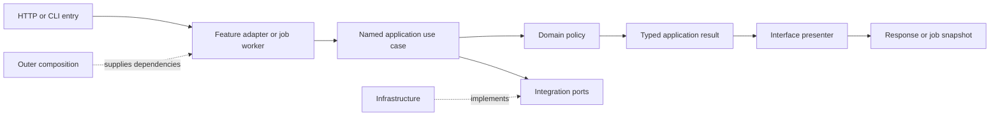

# Item 7a: simplify internal call paths

**Status:** approved, deployed and merged in PR #67 on 2026-10-26. Source
`fca21e5` was deployed as Space revision
`b1a3c0cec8cf497f6a907147d0cd7824185f5d3a` and merged in `cb6f191`.
All 442 deployed Python paths matched; shared state and data stayed unchanged.
Authenticated before/after checks passed for all four durable artifacts and
20 active-job endpoints. [Item 8](ASYNC_SPOTIFY_TRANSPORT.md) follows this release.
The architectural direction was approved on 2026-10-03.

Item 7 PR #66 was approved, deployed to Space revision
`702365bae980a4a7f0036f36bb24a7f4239d5cfc`, and merged. All 155 deployed paths
matched the approved source; durable state/data revisions were unchanged.
Production check-only runs `37125691360` and `37126187525` passed before and
after deployment, including all 20 active-job endpoints. The four local runtime
data changes were preserved in a named stash; older stashes remain intact.

The decision is recorded in [ADR 003](../adr/003-direct-use-case-paths.md).
The frontend remains part of compatibility verification; restructuring its
HTML, CSS and JavaScript is reserved for a future targeted refactor.

## Implementation order

1. Inventory each family in the [roadmap migration inventory](../REFACTOR_ROADMAP.md#routine-migration-inventory-for-steps-6-and-9).
   Record HTTP and CLI entries, worker dispatch where applicable, the named
   application use case, policies, integrations and result presenter. Mark each
   compatibility seam as public, internal, or a justified temporary exception.
2. Simplify the album-evaluation path first. Separate dependency construction
   from use-case invocation and wire both HTTP and CLI adapters directly to the
   application operation. Keep the legacy public evaluation helper callable.
3. Simplify Sauvignon next. Retain its worker-owned choice/cancellation signals
   and presenters while removing the routine/bootstrap forwarding detour from
   normal execution. Verify choices, retries, effect boundaries and cleanup.
4. Apply the same approach to the remaining routine families, analysis and
   operational commands. Resolve bootstrap/infrastructure lookups back into
   routine globals; use explicit dependencies and default implementations.
5. Remove superseded internals only after both direct and compatibility entry
   paths have equivalent or stronger behavior coverage. Keep public imports,
   framework metadata and supported override boundaries.
6. Update the family request/return map and add focused dependency checks. Run
   the full verification gates, start the local web environment and open the
   dedicated PR. Obtain approval before deploying or merging.

## Following a request and its result

Start with the frontend's request URL in `frontend/index.html`. Match its
`@app.api_route` declaration in `api.py`, immediately above the endpoint. The
endpoint calls a named feature function in `interfaces/http/handlers/`, or the
application operation directly for album evaluation. Handler functions validate
input and call the explicit job starter in `interfaces/http/jobs.py`. The starter
reserves a handle and dispatches its named worker. Follow the worker's `_execute`
method into the shared invocation and then its named application stages. There
are no router factories or injected handler-function containers.

CLI commands in `main.py` construct adapters in `interfaces/cli/features/`.
Adapters call the same shared invocation and their own prompt/render methods
directly. Public `main.py` helpers remain external compatibility entries; normal
execution does not return through them.

`interfaces/operations/` contains invocation functions shared by CLI and HTTP.
They assemble existing typed dependencies and call application stages. The
business decision stays in `application/` and `domain/`; the invocation function
does not choose tracks or change effect order. `bootstrap/` supplies concrete
catalog, file and state dependencies. Construction does not advance a workflow.
Some operations must read inputs between stages; those observations retain their
original order and resource scope.

For album evaluation, follow this complete path:

```text
frontend/index.html: album request
  → api.py: @app.api_route("/albums/evaluation", methods=["GET"])
  → api.album_evaluation
      validates AlbumReviewRequest through handlers.lookups.album_request
      constructs catalog and membership through bootstrap.listening.album_review_ports
  → application.album_review.review_album
  → domain.albums.assess_album
  ← AlbumReview
  → interfaces/presenters/albums.album_evaluation
  ← AlbumEvaluation → HTTP response
```

The CLI's `LookupsCLI` calls `lookup_operations.evaluate_live_album`, which
constructs the same ports and calls `review_album` with `AlbumReviewRequest`.
The public processor helper remains an external compatibility entry; normal
CLI/HTTP execution does not call it.

## Family request and return map

Paths in the operation column are relative to `spotify_manager/interfaces/`.
HTTP workers are in `http/workers/`, CLI adapters in `cli/features/`. Returned
application values go to the named HTTP presenter, or to the CLI adapter's Rich,
JSON or print rendering. Registration, slot reservation and polling remain
interface mechanics, separate from policy execution.

| Family / feature adapter | Shared operation | Application stages and domain rules | Return path |
| --- | --- | --- | --- |
| Album, artist and track lookups: `lookups` | HTTP album: direct `review_album`; CLI album and remaining lookups: `lookup_operations.py` | `album_review`, `library_lookup_run`, `scrobble_lookup_run`; `albums`, `lookup_selection`, `lookup_seasons` | `AlbumReview` → album presenter → `AlbumEvaluation`; existing statistics/status wire models → handler or CLI |
| Blast: `historical`, `blast` | `operations/blast_from_past.py` | `BlastSelection`, `BlastPlaylist`, `HistoricalResolution`; calendar and historical matching policies | Historical summary → `http/presenters/historical.py` → job snapshot; CLI historical renderer |
| Daily Mind Radio: `daily_mind_radio`, `historical` | `operations/daily_mind_radio.py` | `AnniversarySelection`, `AnniversaryPlaylist`, `HistoricalResolution`; anniversary and matching rules | Daily summary → historical presenter → job snapshot; CLI historical renderer |
| Dormant artists: `dormant`, `blast_artist`, `historical` | `operations/blast_from_past_artists.py` | `DormantRecovery`, `DormantLikedTrack`; dormant-year intersection and preferred liked track | Dormant summary → historical presenter → job snapshot; CLI historical renderer |
| Found Art: `found_art` | `operations/found_art.py` | `RecommendationRun`, seed/candidate/resolution stages; recommendation history, ranking and matching | `FoundArtSummary` → recommendations presenter → job snapshot; CLI recommendation rendering |
| Sauvignon: `sauvignon` | `sauvignon_operations.py` | `SauvignonRun`, album gathering and selection; album recommendation and selection policies | `SauvignonSummary` → recommendations presenter → job snapshot; CLI Sauvignon rendering |
| Queue fill: `queue_fill`, `queue` | `operations/the_queue.py`: `fill_queue_from_lastfm` | `QueueFill`, `QueueSeeds`, `QueueRecommendations`, artist mapping; seed/ranking/exclusion rules | Fill summary → queue presenter → job snapshot; CLI queue renderer |
| Queue flush: `queue_flush`, `queue` | `operations/the_queue.py`: `flush_queue` | `QueueFlush`, planning/execution; artist assessment, top-track progression and accepted-effect rules | Flush summary → queue presenter → job snapshot; CLI queue renderer |
| New Kids and Queue 2: `discovery`, `new_kids`, `queue_2` | `operations/new_kids.py` | Review inputs → discovery session/planner/execution → `DiscoveryReview`; Queue 2 prefill retains its separate stage | Discovery/Queue 2 summary → discovery presenter → job snapshot; CLI discovery renderer |
| Queue 3: `queue_3` | `operations/queue_3.py` | Annual input observations/import → `Queue3Run`/`Queue3Review` → completion; annual import and studio progression policies | Annual/flush summary → discovery presenter → job snapshot; CLI Queue 3 presenter |
| New Wine: `wine`, `new_wine` | `operations/new_wine.py` | New Wine planning/observations/execution, Wine Cellar refill; release progression and library affinity | New Wine summary → wine presenter → job snapshot; CLI wine renderer |
| Slow Listening: `slow_listening` | `operations/slow_listening.py` | Slow-listening plan/run/state; chronological studio-release progression | Slow summary → slow-listening presenter → job snapshot; CLI slow renderer |
| Something Old: `something_old` | `operations/something_old.py` | `SomethingOld`, golden selection and artist mapping; Golden Oldies and track-selection rules | Golden summary → Something Old presenter → job snapshot; CLI golden renderer |
| Release check: `releases`, `release_check` | `operations/release_check.py` | `ReleaseRunOpening` → release-review/run stages; windows, ranking, pending singles and destinations | `ReleaseCheckSummary` → releases presenter → job snapshot; CLI release renderer |
| Palace: `palace`, `palace_of_memory` | `operations/palace_of_memory.py` | Saved-album mirror/history/cursor → `PalaceRun`; alphabetical and historical planning | Palace summary or cursor → historical presenter/handler → snapshot/response; CLI palace renderer |
| Discography: `discography` | `operations/discography.py` | `DiscographyPlanning` and `DiscographyExecution`, catalog/queues/history; priority and week-size selection | Plan/summary → discography presenter → job snapshot; CLI release-selection tables |
| Annual retrospective: `new_year` | `operations/new_year.py` | New Year sources/plan/resolution/execution; annual charts and checkpointed marker stages | Original result dictionary → worker snapshot or CLI rendering |
| Genre: `genre` | `operations/genre_reveal.py` | `GenreReveal`, source discovery and progress; genre route/state rules | Completed genre result → genre handler or CLI; web completion state retains its separate adapter |
| Artist review: CLI `artist_review` | `operations/review_artists.py` | Artist review session/catalog/decisions/run/completion; library/queue eligibility and recovery | Review summary → CLI review tables and prompts |
| Album limits and recovery: CLI `album_review`, `recovery` | `operations/review_album_limits.py`, `operations/recover_removed_albums.py` | Album-limit/recovery workflows and credited-artist effects; album decisions and future-release recovery | Typed review/recovery summary → CLI presenters |
| Requeue: `requeue`, `requeue_for_a_dream` | `operations/requeue_for_a_dream.py` | `flush_requeue`; marker identity and chronological progression | Requeue summary → historical presenter → job snapshot; CLI requeue rendering |
| History: `history`, `scrobble_history` | `operations/scrobble_history.py` | `HistoryRefresh`; history merging and accepted publication order | History summary → historical presenter → job snapshot; CLI history renderer |
| Mirror analysis: `analysis`, `analysis_worker` | `operations/analyse_library.py` | Checkpoint/session/resource scans/export/publication; mirror records, continuation and reconciliation | Sync summary → analysis presenter/worker → result; CLI analysis output |
| Upload: CLI `library_upload` | `operations/upload_library_files.py` | Upload plan/materialization/publication; path and part-manifest rules | Plan/summary → CLI upload rendering |
| Legacy maintenance: `library_commands` | `operations/legacy_library.py` | Comparison/conversion/restoration/count, monthly control/statistics/playlist, incremental album refresh; legacy cursor/batching/statistics | Original None/count/albums → CLI output or existing synchronous HTTP response |

The before paths were adapter → routine/processor forwarding entry → bootstrap
execution helper → application. Both supported public compatibility entry points
and normal CLI/HTTP entries now converge on the shared operation. Infrastructure
binds concrete functions explicitly; it does not locate its execution dependencies
by looking up mutable routine/processor module globals.

## Ownership after simplification



Keep dependency construction at the scope the resource needs. Shared resources
may be initialized at startup; a job's interaction state and observers are owned
by that invocation. Do not turn synchronous resources into new global singletons
or change when clocks, settings, source snapshots or credentials are observed.
Async client/task ownership remains Items 8–9.

## Cohesive inputs and concrete resource owners

Request values, named interaction owners and persistence resources are separate
frozen models in `interfaces/requests/`. An invocation normally takes a client,
options, interaction owners and resources. No production function has more than 13
parameters; generated delivery/request constructors have the same ceiling.
Grouping follows a shared purpose rather than wrapping an arbitrary dependency
list. `NewWineOptions`, for example, describes selection/dry-run values,
`NewWineCallbacks` holds named decision and notification resources, and `NewWineStorage`
describes state/mirror/audit locations.

`PlaylistContext` owns the registry, lock, log formatter, clock and logger used
by one worker. Workers call concrete presenters and `PlaylistRetry` methods
directly. They retain their original signals and observer-restoration order.
`ConsoleDisplay` and `ProgressDisplay` group terminal rendering constructors;
they do not select or execute business stages.

`bootstrap/clients.py` is the sole constructor owner for `LastFmClient`.
HTTP and CLI adapters provide `LastFmCredentials` there; routine files are no
longer part of client construction. Bootstrap only builds dependencies.
Discovery input acquisition lives in `operations/discovery_inputs.py`,
discography observations in `infrastructure/discography_observations.py`,
and annual resource effects in `infrastructure/legacy/new_year_resources.py`.
Their reads, clocks and effects retain the original stage order.

## Application-to-domain revision (2026-10-19)

Fixed domain functions are imported and called at their decision sites. Historical
selection calls the calendar and scrobble rules directly; recommendation and
Queue stages call listening-week, ranking and release-evaluation rules directly.
The listening calendar now only observes/converts dates. It does not choose a
business week on behalf of the application.

Coordinators receive concrete named stages, rather than `stage.run` or
`stage.plan` callbacks. `RecommendationStages`, `SauvignonStages` and
`QueueFillStages` group actual application objects, with explicit concrete types
that support editor definition lookup. Catalog, playlist, state and history
boundaries expose named methods; their implementations perform external reads
and writes rather than running selection stages behind an adapter method.

For example, follow these calls in source:

```text
BlastPlaylist.run
  → BlastSelection.run → eligible_dates / select_scrobble
  → HistoricalResolution.run → qualifying_matches / preferred_match
  ← historical summary → interface presenter

QueueFill.run
  → QueueSeeds.select → listening_week_start / select_seeds
  → QueueRecommendations.run → recommendation ranking rules
  → QueueArtistMapping.resolve → ArtistMapping.run → artist mapping rules
  ← fill summary → queue presenter

NewYear.run
  → AnnualPlanning.run → HistoryRefresh.run → rank_year
  → AnnualExecution.run → AnnualCharts.run / AnnualMembership.run
  → AnnualDiscoveries.run → AnnualImportReview.run → annual import rules
  ← retrospective result → annual presenter
```

Palace calls its mirror and history stages directly. New Wine calls its cellar
stage directly. Queue flush calls its planning stage, which directly invokes
artist assessment. Release checking calls named mapping and containing-record
stages. Discography planning calls queue, history, mapping and catalog stages
without an infrastructure detour. The annual execution sequence has five explicit
calls and accepted checkpoints instead of a tuple of executable callbacks.

Operator choices, progress, cancellation, clocks and retries now use named
resources with explicit methods. Checkpoint ownership is explicit through named
stores. Fixed domain functions are called at their decision sites; source guards
reject policy injection and replaceable function-valued dependencies, including
aliased imports. Only required external API function arguments remain.

The original expected results, ordered effects and failure/restart traces are
unchanged. Unit coordinators use typed child-stage doubles; the actual named
stages also execute in isolated application tests and compatibility tests.

## Ordinary I/O and execution dependencies (2026-10-20)

Internal resource models no longer contain file readers/writers, serializer
functions, validation functions, catalog readers, audit appenders or checkpoint
callbacks. Protocols describe named I/O methods; concrete adapters own the client,
path, schema or current namespace needed to implement them. Application stages
call fixed domain functions directly and invoke other application stages by name.

| Path | Calls visible in application execution | External resource ownership |
| --- | --- | --- |
| Live artist statistics | `artist_statistics` → `artist` → release membership → tracks → liked membership | `SpotifyArtistLookup`, saved/liked membership readers |
| Monthly library maintenance | `run` → `check` → `update_statistics` → `add_monthly` → `monthly_slice`, playlist and track stages | Named files, catalog, playlist writes and clock |
| Mirror analysis | Export preparation or offset/cursor scan → fixed resource decoding → publication/checkpoint | `AnalysisStorage`, `SpotifyAnalysisCatalog`, `SpotifyOffsetPages`, `AnalysisBackups` |
| Artist review | `ReviewSession` → `ReviewCatalog.tracks/ranked/earliest` → `ArtistCatalog` → fixed candidate rules | Per-artist cache/read objects and whole-state checkpoint stores |
| Upload | `prepare` → fixed manifest rules; `upload` → remote read → local publication → manifest → commit | `ExportPreparation`, `HubUpload` |
| Nightly refresh | `nightly_refresh` → freshness rule → `run_job` → `start_job` → `poll_job` → `cancel_job` when needed | `SpaceHttpClient` exposes HTTP and decoded artifact observations |
| HTTP result handling | Worker → feature-specific plural presenter → job snapshot | Context owns registry, lock, clock and log formatting |

The CLI owns one lazy `CommandResources` object rather than a set of factories
and forwarding functions. Its feature adapters call shared operations and named
formatters directly. Ordinary routine state access uses `routine_state_from`
with a named `*StateCodec`; HTTP namespace edits use the same schema methods.
Genre discovery uses a `GenrePages.read` resource. Golden-track selection, release
pages, recommendation decoding, history export and queue decoding call their
fixed transformations directly.

The 2026-10-23 clarification removes the earlier operator/runtime and public
Python callback exemptions. Choices, progress, SDK event output, retries,
cancellation, time, randomness, waits, lazy clients, genre pages and membership
reads all use named resources with explicit methods. State defaults, validators
and legacy file formats belong to named schemas/codecs. The historical
`*Callbacks` request containers now contain those resources, not functions.

| Remaining function value | Why the external API requires it |
| --- | --- |
| FastAPI/Starlette/Typer registrations and dependency providers | The framework invokes the registered function. |
| Thread targets | `threading.Thread` invokes its required target. |
| Dataclass factories, ordering keys and JSON fallback | These standard-library APIs require a factory/key/encoder function. Fixed key functions remain at their actual ordering call sites. |
| `SpotifyOffsetPages._method` | Retain the endpoint selected once at the original scan boundary. |
| `SpotifyEvents._setter` | Restore through the exact optional setter observed before subscribing. |

`tests/bootstrap/test_callback_dependencies.py` checks function-shaped fields and
parameters, including imported/reexported aliases and callable protocols. A
second scan checks actual named-function, lambda and bound-method arguments,
including aliases and the standalone nightly script. Reasons are recorded in
`tests/support/callback_policy.py`; ordinary execution injection has no exception.
The separate fixed-policy and facade guards continue to apply.

## Acceptance and evidence

- Every command/routine family has an explicit entry, use case, policy and return
  path. A reviewer can follow it without a generic dispatcher or service locator.
- After entering the feature adapter, normal internal execution does not detour
  through API/CLI or legacy routine/processor facades. Any retained exception has
  a named contract, justification and removal or retention decision.
- Each retained wrapper performs distinct validation, construction, interaction,
  business sequencing or presentation. Meaningful application stages remain;
  helper count and file count are not success metrics.
- HTTP/CLI entry points, signatures, imports, override behavior and all 11 frozen
  artifacts remain compatible. Original fixtures and their expected effects
  remain unchanged; internal test wiring may migrate only with equal or stronger
  coverage of the same behavior.
- Direct and compatibility entry paths are covered for success, validation,
  retries, choices, cancellation, accepted writes, checkpoints and failure
  recovery where applicable. Compare ordered results, effects and relevant events.
- Existing job evidence still covers conflicts, registry locks, dispatch failure,
  snapshot isolation, callback restoration and concurrent choice/cancellation.
- The full randomized suite, Ruff, typing and structural checks pass. Retain the
  approved 95% statement / 90% branch package gates and 98% / 95% inner-layer
  gates. Add focused checks for newly eliminated dependency detours; human
  readability review remains necessary.
- Local web integration checks cover health, data/state, job polling, choices,
  cancellation, reconnecting and password gating. Tests use offline fixtures and
  fakes; the local smoke check does not require live Spotify mutations.

## Retained boundaries and removal decisions

- **Public compatibility entries:** keep routine/processor imports and unchanged
  HTTP/CLI signatures, defaults and schema text. As approved in the 2026-10-05
  review, Python callers of the oversized execution signatures now supply typed
  request/callback/resource models. These wrappers serve external callers;
  bootstrap and infrastructure must not call their execution facades. The
  dependency regression guard enforces that distinction.
- **Original SDK source contract:** concrete read/write leaves remain in their
  original source files because the frozen SDK inventory includes source paths
  and receiver expressions. Explicit imports bind those implementations. Keep
  these leaves through Items 8–9; asynchronous replacements require the approved
  transport migration and equivalent ordered-call evidence, rather than silently
  moving a frozen expression in Item 7a.
- **File, codec and validation contracts:** helpers that implement actual file
  formats, state compatibility, resource validation or interface parsing retain
  those distinct responsibilities. Bootstrap now binds file functions at their
  concrete owners. Keep the supported helper imports; internal execution must not
  re-enter a primary routine merely to reach a business use case.
- **Clock/settings observation contracts:** original module clocks, live legacy
  settings, limits and default values remain where moving their observation
  would change timing or public defaults. Builders defer those reads to the
  original stage. Keep these observations through async migration and explicitly
  pass new lifetime dependencies when that migration addresses their ownership.
- **Threaded job ownership:** workers still own choice/cancellation signals and
  callback cleanup. Keep these meaningful contexts under ADR 002. Native async
  clients and tasks belong to Items 8–9.
- **Unexpected job failure boundary:** retain the existing outer worker catches
  that publish a failed status and restore callbacks. Removing them would change
  the frozen unexpected-error/cleanup contract. No new blanket business catches
  are introduced.

The [named helper inventory](RETAINED_LEGACY_HELPERS.md) identifies every explicit
legacy helper binding, its family contract and retention decision. These are
concrete implementations or compatibility exports, not a generic dispatch layer.

## Verification record

Internal fixture substitutions moved from forwarding globals to the same typed
ports and concrete effect owners used by normal execution. Existing fixture
bytes, expected results, ordered effects, error prefixes, checkpoints and restart
recordings were not changed. New tests reject execution-facade dependencies and
mutable facade-function lookup, prove aliases/re-exports are detected, and cover
fresh-process entry import orders.

Final verification of the 2026-10-26 revision:

- **10,454 tests passed**, randomized seed `20261026`. All original behavior
  scenarios remain; the old guard permitting replaceable operator/runtime hooks
  is replaced with rejection cases. Retry tests cover accepted writes with lost
  responses, failure identity, cancellation and attempt ordering.
- Package statement coverage: **96.19%** (32,941 / 34,244); branch coverage:
  **92.67%** (5,566 / 6,006). Both exceed the approved 95% / 90% gates.
  Combined coverage is **95.67%**, also passing the stronger final 95% gate.
- Separate isolated gates passed **1,201 domain** and **3,645 application** tests
  with **100% statement and branch coverage**. The application gate includes
  direct retry attempt scopes and their cancellation/acceptance boundaries.
- Ruff and formatting pass across **1,027 Python files**. Package and standalone
  nightly-script mypy pass **638 source files**. Strict domain, application,
  their tests and shared test support pass **449 source files**.
- Changed/new production and test functions pass the structural audit: no local
  functions/classes, compound comprehensions, incomplete annotations, functions
  above 25 executable statements, or control nesting above two. The production
  audit also checks multiline comprehensions, docstring arguments and generated
  input-field counts. Public signatures and generated constructors retain the
  13-parameter ceiling and cohesive typed inputs.
- A fresh capture matches all **11 frozen public artifacts**. Baseline source
  locations may move; route metadata, SDK expressions/source ownership, schemas,
  defaults, imports and CLI contracts retain their approved comparison rules.
  The interface checker recognizes only the equivalent direct SDK expression
  replacing a `partial` wrapper; arguments, payloads and call counts remain
  checked. Baseline files, frontend source and expected behavior fixtures are
  unchanged.
- Dependency checks reject inward execution through legacy facades, mutable
  facade-function lookup, injected fixed domain rules and unrecognized function
  dependencies. Function aliases, bound-method aliases, protocols and reexports
  are covered, including the standalone nightly entry point. Only required
  framework/standard-library uses and two exact SDK captures are retained.
- Local review server: **http://127.0.0.1:8766/** on the revised branch. Local
  unlock uses any non-empty text. Read-only review smoke checks pass for health,
  source and shared-state loading, and all 20 job reconnect endpoints; no jobs
  are active. No routine or Spotify mutation is part of these smoke checks.

The four hydrated local runtime-data files are excluded from the implementation
commit and retained for review. The previous Item 7 release stashes remain intact.
This item keeps synchronous transport and the existing frontend source layout;
Items 8–9 handle async transport and lifetime ownership after approval/release.


## Owner clarification, 2026-10-23: function arguments

Named operator interactions, notifications, clocks, cancellation, randomness,
waiting and retries replace function-shaped dependencies too. A callback's role
alone does not justify it. Readability takes precedence over convenience and
configurability; use direct named calls or cohesive objects with explicit methods
whenever they can preserve the same behavior. Compatibility APIs receive named
schemas and resources rather than retaining unnecessary function arguments.

Function arguments remain appropriate only where an external framework or a
standard-library API actually requires them, such as registered routes, thread
targets, dataclass default factories and sorting keys. The dependency guard permits
only two private SDK method captures: the selected library page endpoint and the
optional event setter restored after a job. They preserve the original lookup
and binding time; they are not supplied business execution dependencies.

Retry attempt scopes keep the concrete operation visible at its call site. Each
scope preserves the original failure classification, attempt count, wait,
cancellation and accepted-result boundary. Python wiring and test doubles may
change; frozen HTTP/CLI results, SDK calls, errors and ordered effects do not.

This clarification extends the existing Item 7a PR. The October 26 verification
record above covers the tightened rule, including operator/runtime and public
Python interfaces. The owner subsequently approved and released PR #67.
